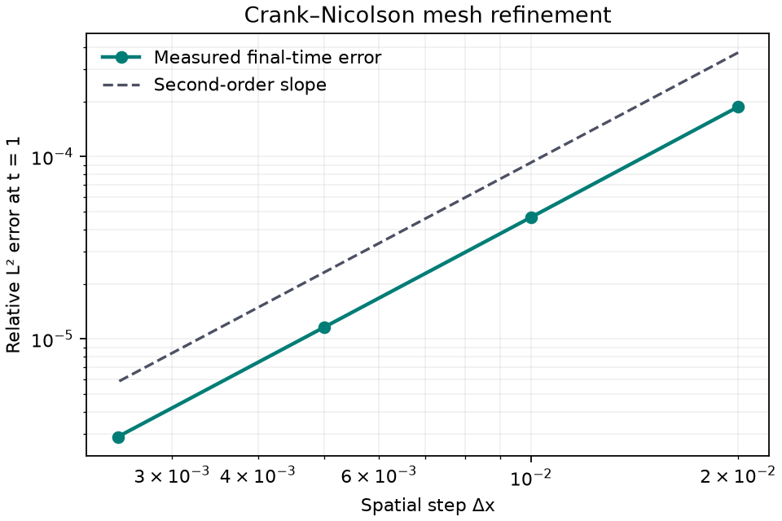
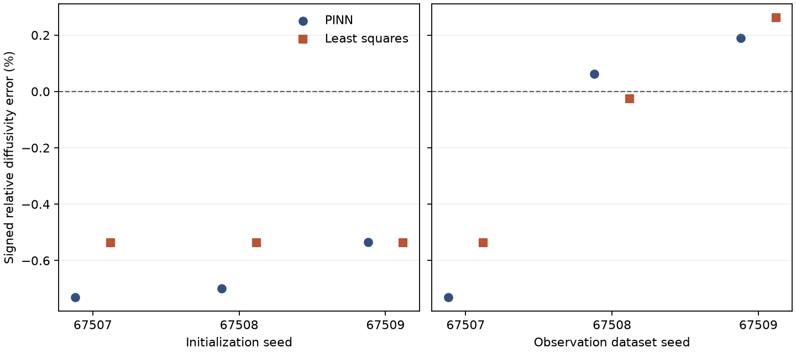

# Physics-informed learning for heat transfer

This independent, AI-assisted scientific computing project was inspired by IAM 774 Scientific Machine Learning material and developed outside the course grading process. It compares an analytical solution, a Crank–Nicolson solver, and a soft-constraint PyTorch PINN for one-dimensional transient heat conduction. The inverse experiment estimates diffusivity from noisy synthetic measurements and compares it with nonlinear least squares.

## Model

$$
u_t=\kappa u_{xx}-\lambda u,\qquad
u(0,t)=u(1,t)=0,\qquad
u(x,0)=\sin(\pi x)+a\sin(4\pi x).
$$

The domain is $[0,1]^2$ in $(x,t)$. The illustrative coefficients are $\kappa=0.030$, $\lambda=0.875$, and $a=0.60$. The analytical field is the sum of the two initial sine modes, each decaying at rate $\kappa(n\pi)^2+\lambda$. The PINN maps $(x,t)$ through three fully connected, width-32 tanh layers to scalar temperature. Its objective combines the mean squared PDE residual, boundary error, and initial-condition error. The inverse objective adds a mean squared observation term and jointly trains $\log\kappa$.

## Results

| Forward method | Full-grid relative L² | Relative L² at t = 1 | Construction time |
|---|---:|---:|---:|
| Crank–Nicolson, 400 spatial intervals and 800 steps | 1.269e-5 | 2.905e-6 | 28.30 ms median solve |
| Soft PINN, three seeds | (7.743 ± 1.322)e-4 | (2.199 ± 0.230)e-3 | 97.64 ± 5.59 s training |

The PINN row gives mean ± sample SD. Both methods were scored against the analytical field on the same 101 × 101 grid. PINN inference time was unmeasured. The forward benchmark showed second-order mesh convergence, and the three PINNs had held-out residual RMS between 0.00300 and 0.00458.

| Inverse observation seed | PINN κ | Least-squares κ | PINN field relative L² | Least-squares field relative L² |
|---:|---:|---:|---:|---:|
| 67507 | 0.02978088 | 0.02983911 | 1.724e-3 | 1.079e-3 |
| 67508 | 0.03001855 | 0.02999201 | 1.148e-3 | 5.341e-5 |
| 67509 | 0.03005657 | 0.03007856 | 8.347e-4 | 5.248e-4 |

All five inverse PINNs recovered $\kappa$ within 0.74%. With observations and collocation fixed, the PINN diffusivity sample SD across initializations was 3.17e-5. Varying the full observation draw at fixed initialization increased it to 1.49e-4. Least squares had lower field error on each dataset. Observation RMSE measures fit to training readings and is reported separately.

These results cover one smooth equation, three seeds per comparison, 100 synthetic readings per dataset, and one noise level. The observation draws change both placement and noise realizations. The effect of noise alone and performance on other PDEs are outside the measured scope.

[Technical report](TECHNICAL_REPORT.md) · [Forward seed table](results/forward/robustness.csv) · [Inverse seed table](results/inverse/robustness/inverse_robustness_summary.csv) · [Diffusivity trajectories](results/inverse/robustness/kappa_convergence.png)

## Setup and reproduction

Use CPython 3.14.5. The audited setup used 64-bit Windows and CPU PyTorch. Run from the repository root in PowerShell.

~~~powershell
py -3.14 -m venv .venv
$python = ".\.venv\Scripts\python.exe"
& $python -m pip install -r requirements-pinn.txt -c constraints-windows-cpu.txt
& $python -m pip check
& $python -m pytest -q
& $python verify_release.py
& $python reproduce.py
~~~

The last command rebuilds the benchmark and both seed-67507 PINNs under the ignored .reproduction directory and compares their arrays with the archive. Add --full and a fresh --output path to rebuild both robustness studies as well. The figure check regenerates the complete archive of plots from the saved numerical data and verifies checkpoint predictions. [Detailed commands and audit](REPRODUCIBILITY.md)

| Path | Contents |
|---|---|
| heat.py, benchmark.py | Analytical solution, Crank–Nicolson solver, and convergence benchmark |
| pinn.py, train_forward.py, plot_forward.py | PINN residual, forward training, and plots |
| inverse.py, train_inverse.py | Synthetic observations, inverse fitting, and least squares |
| forward_robustness.py, inverse_robustness.py, summarize_inverse_robustness.py | Seed studies and summaries |
| case.json, pinn_config.json, inverse_config.json | Experiment settings |
| tests/ | Numerical checks, checkpoint round trips, and RNG reproducibility tests |
| results/ | Checkpoints, data, timings, loss histories, and figures |
| reproduce.py, verify_release.py | Isolated replay and archive verification |

## References

- J. Crank and P. Nicolson (1947). Original heat-conduction finite-difference method, *Mathematical Proceedings of the Cambridge Philosophical Society*, 43, 50–67. [Publisher record](https://www.cambridge.org/core/journals/mathematical-proceedings-of-the-cambridge-philosophical-society/article/abs/practical-method-for-numerical-evaluation-of-solutions-of-partial-differential-equations-of-the-heatconduction-type/B3230893A53384D418228AB39D41A451)
- M. Raissi, P. Perdikaris, and G. E. Karniadakis (2019). Physics-informed neural networks for forward and inverse PDE problems, *Journal of Computational Physics*, 378, 686–707. [Forward-method preprint](https://arxiv.org/abs/1711.10561) · [Inverse-method preprint](https://arxiv.org/abs/1711.10566)

## AI assistance and licensing

OpenAI Codex assisted with implementation, tests, figures, documentation, and the release audit. Numerical claims are based on executed runs and archived artifacts. The repository contains original project files and synthetic data. [MIT license](LICENSE) · [Dependency and provenance notes](REPRODUCIBILITY.md#release-scope-and-licensing)
